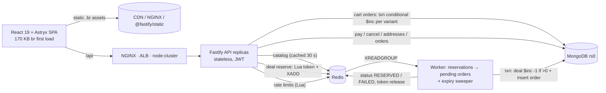
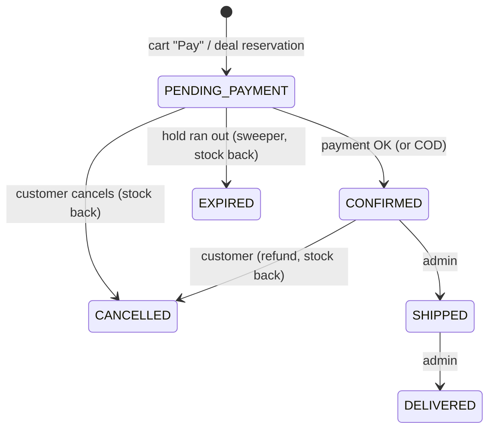

# FlashSale — Phone Store with High-Concurrency Flash Deals (MongoDB · Fastify · React · Node + Redis)

> **For future Claude sessions:** this file is the project's instruction file *and* its study guide. Keep it in sync with the code.
> Conventions: ES modules everywhere · **Fastify 5** (routes are plugins in `backend/src/routes/`, request validation = JSON Schema compiled by Ajv, hooks/guards in `backend/src/plugins/`) · business logic only in `backend/src/services/` · all Redis keys via `keys.*` in `backend/src/lib/redis.js` · all atomic Redis logic as Lua in `backend/src/redis/scripts.js` · never read `process.env` outside `backend/src/config/env.js` · money is integer paise (`*Cents`) · every order state change is a **conditional** update on the current status.
> Frontend: React 19 + **Astryx** design system (`@astryxdesign/core` 0.7.4, pinned — it is a 0.x beta); import components per entry (`@astryxdesign/core/Button`); Astryx inputs call `onChange(value, event)`; boolean props are `is*`/`has*`; spacing props take numbers (`gap={4}`). Use theme tokens (`var(--color-…)`) in CSS; colour is only a hint.
> Tests run against real MongoDB + Redis (§6). **The C: drive on this machine is full — keep npm cache / TEMP on E: (§12 E1).**

Status (2026-10-28, session 2): **full storefront implemented and verified end to end** (browse → product → cart → address → delivery → payment → confirmation → orders → cancel; flash-deal reserve → hold → pay; admin fulfilment). NGINX/CDN remain *provided, not verified*. See §3, §11, §15.

---

## 1. Project Overview

**Problem (case study).** A festival flash sale releases **500 smartphones at exactly 8:00 PM**; **>100,000 concurrent checkout requests** arrive in the first 10 s. Earlier trials had latency spikes, DB row-lock timeouts and **overselling (540 orders for 500 phones)**.

**What was built.** A real phone e-commerce site — catalog of 10 current phones (75 colour/storage variants), search/filters, product pages, cart, multi-step checkout with saved addresses, delivery options and (simulated) UPI / card / cash-on-delivery payments, order tracking and cancellation, an admin dashboard — plus **flash deals** that implement the case study's architecture: a Redis atomic admission gate, a queue, ACID persistence, and a timed checkout hold.

**Users.** Shoppers (guest browsing, account for checkout) and admins (schedule deals, watch consistency, ship/deliver orders).

**Verified outcomes.** 40,000 deal requests from 10,000 buyers → exactly **500** reservations/orders, **0** errors/timeouts/5xx, **4,379 req/s, p99 305 ms** on a 4-process Fastify cluster (≈2× the Express version, §11). Initial page download **170 KB Brotli** (≤ 200 KB budget).

**Technology stack.**
| Layer | Tech | Why |
|---|---|---|
| UI | React 19.3, **Astryx 0.7.4** (theme-neutral), lucide icons, Vite 6 | Accessible component system; neutral look with colour hints |
| Routing / data | ~70-line History router with params, `useApi` cache hook, `fetch` | Fewer KB than React Router / TanStack Query for 12 screens |
| API | **Node 24 + Fastify 5.12** (Ajv JSON-schema validation, fast-json-stringify, @fastify/helmet, compress, static) | ~1.5–2× Express throughput; schema-first validation |
| Fast path | **Redis** (Lua scripts, Streams consumer group) | Atomic stock tokens, queue, rate limits, catalog cache |
| Durable store | **MongoDB 8.3** replica set + Mongoose 8 | Multi-document ACID transactions, conditional updates |
| Auth | JWT (HS256) + bcryptjs | Stateless — any replica verifies any request |
| Tests | `node:test`, `fastify.inject`, autocannon | No extra frameworks |

## 2. Original Problem Statement

Source: `Fullstack_Placement_Case_Study.docx` (read in full in session 1). Core table:

| Layer | Challenge | Target |
|---|---|---|
| Frontend | Prevent API spamming from rapid clicks; graceful loading/failed queues without freezing | Bundle < 200 KB, TTI < 1.5 s |
| API gateway | Ingest parallel traffic without drops; block bots; distribute load | Rate-limit bad actors; 0 % dropped requests |
| Application | Decouple heavy DB writes from HTTP; high concurrency | Stateless clusters; event-loop safety |
| Database | Exactly 500 sold; no app-level double counters; no row-lock timeouts | ACID; atomic decrements |

Reference solution: UI lock on first click, CDN assets, polling/SSE · LB → stateless servers, Redis inventory token, queue → `202 Accepted` + polling URL · consumers run a transaction with `… WHERE stock > 0`.

**Session-2 user requirements (in addition):** "think how a real application would work from entering to ordering to exit; a proper e-commerce site with actual phones, multiple products, proper checkout page; use Astryx UI; remove the colourful UI, apply just colour hints; check the requirement and suggest what would make the backend better; Express was only an example — use current technologies that make the app efficient."

### Ambiguities → decisions
| # | Question | Decision |
|---|---|---|
| A1 | Interview case study vs app | Real store whose flash-deal path implements the reference architecture |
| A2 | RabbitMQ/Kafka "e.g." | Redis Streams consumer group (installed, durable, acked); reserve+enqueue in one Lua script |
| A3 | SQL conditional UPDATE | Mongo `findOneAndUpdate({remainingStock:{$gt:0}}, {$inc:-1})` in a transaction |
| A4 | Per-user limit | 1 unit per customer per deal (Redis buyers hash + unique `activeDealKey` index) |
| A5 | "Bundle < 200 KB" | **Transfer size** of the initial JS+CSS, measured as the Brotli files actually served (raw/gzip reported too). Changed from raw in session 2: Astryx ships one prebuilt 220 KB stylesheet |
| A6 | 100k req / 10 s | Not reproducible on one laptop; strongest local tests reported honestly |
| A7 | CDN / NGINX | Hashed immutable assets + precompressed Brotli implemented; `infra/nginx.conf` unverified |
| A8 | Auth | Email/password + JWT; roles customer/admin |
| A9 | Polling vs SSE/WebSockets | Adaptive, jittered polling of a 1-s cacheable endpoint (§16) |
| A10 | Payments (user chose) | **Simulated gateway** (§10) — realistic validation, declines, idempotency; no real money |
| A11 | Backend framework (user chose) | **Migrated Express → Fastify** |
| A12 | Flash deal checkout | Real-world pattern: winning the deal *reserves* a unit for N minutes (default 10) while the customer enters address + pays; unpaid holds expire and the unit returns to sale. Deals are prepaid only |
| A13 | Cart | Browser-held (guests can shop); server re-prices and re-validates everything |

## 3. Requirement Traceability Matrix

Legend: **Verified** = implemented + evidence in §11.

| ID | Requirement | Implementation (key files) | Evidence | Status |
|---|---|---|---|---|
| R1 | Deal opens/closes at exact time | Lua checks window with Redis `TIME`; client countdown synced to server clock (`redis/scripts.js`, `components/Countdown.jsx`, `lib/polling.js`) | deals.test window; browser countdown → Live | **Verified** |
| R2 | Exactly N sold, zero oversell | Redis Lua token + Mongo conditional decrement in txn + unique indexes (`orderProcessor.js`) | concurrency.test 1,500→100; integrity.test drift; load tests 500/500 | **Verified** |
| R3 | 202 Accepted + tracking URL | `POST /api/deals/:id/reserve` (`routes/deals.js`) | deals.test full path | **Verified** |
| R4 | Async ACID persistence, sequential consumers | `worker.js`, `services/orderWorker.js`, `orderProcessor.js` | integrity.test (idempotent, race, reclaim) | **Verified** |
| R5 | Client polls status | `GET /api/reservations/:id`, `useReserve` | browser: 5 clicks → 1 POST → 1 poll → checkout | **Verified** |
| R6 | Cheap live deal status | Redis-only `GET /api/deals/:id`, `max-age=1`, adaptive polling | deals.test; browser | **Verified** |
| R7 | Rate limits + bot block | Redis limiter (IP / per-user reserve / auth), UA guard (`plugins/guards.js`) | deals.test 429/403; load test (IP limit hit when proxy misconfigured → found & fixed, §12 E11) | **Verified** |
| R8 | Stateless, horizontally scalable | JWT, all state in Redis/Mongo, `cluster.js` | load tests on 4-process cluster | **Verified** |
| R9 | Event-loop safety | Hot path = JWT verify + 2 Redis calls; writes in worker | p99 135–305 ms under burst | **Verified** |
| R10 | 0 % dropped requests | backlog 4096, keep-alive, fast definitive answers | 20k/20k and 40k/40k answered | **Verified (local)** |
| R11 | UI lock on first click | `useRef` lock + disabled button + server idempotency | browser: 5 same-tick clicks → 1 request | **Verified** |
| R12 | Graceful loading/queued/failed states | state machine `lib/checkout.js`, skeletons, banners, retries, 8 s timeouts | lib.test; browser | **Verified** |
| R13 | Optimistic UI | instant "Reserving…/Securing your unit…" | lib.test | **Verified** |
| R14 | Asset pre-fetching / CDN-ready assets | `<link rel=preload>` for first API calls, idle route-chunk prefetch, hashed immutable assets, precompressed `.br/.gz` | browser resource timing; `curl` shows `content-encoding: br` | **Verified** (CDN itself not deployed) |
| R15 | Bundle < 200 KB, TTI < 1.5 s | route code-splitting, lean shell, budget gate | 170 KB Brotli; localhost warm DOM-interactive 42 ms | **Verified** (no real-network TTI) |
| R16 | Load balancing | `cluster.js` (verified); `infra/nginx.conf` (unverified) | load tests | Cluster **Verified**; NGINX *unverified* |
| R17 | Auth & authorization | bcrypt + JWT, `requireAdmin`, ownership checks | auth.test, orders.test 404/403 | **Verified** |
| R18 | Admin deals + consistency | `routes/admin.js`, `AdminPage.jsx` | deals.test admin; browser dashboard | **Verified** |
| R19 | Validation + central errors | JSON schemas (`schemas/common.js`), `plugins/errors.js` | auth.test bad JSON/validation | **Verified** |
| R20 | Multi-product catalog with real phones | `models/Product.js`, `scripts/catalog-data.js` (10 phones, 75 variants) | seed; browser | **Verified** |
| R21 | Search, brand/price/stock filters, sort, pagination | `catalogService.listProducts` (Redis-cached), `ProductsPage.jsx` (URL = state) | catalog.test; browser filter | **Verified** |
| R22 | Product page with variant pickers & stock hints | `ProductPage.jsx`, `getProduct` | catalog.test; browser (1 TB → "Only 4 left") | **Verified** |
| R23 | Cart (guest-capable) with server pricing | `cart.jsx`, `POST /api/cart/quote` | catalog.test quote; browser | **Verified** |
| R24 | Proper multi-step checkout | `CheckoutPage.jsx` (Address → Delivery → Payment), `POST /api/orders` | orders.test; browser | **Verified** |
| R25 | Saved addresses | `accountService.js`, `AddressDialog.jsx`, `AccountPage.jsx` | auth.test address book; browser | **Verified** |
| R26 | Payments (UPI / card / COD) with declines + idempotency | `paymentService.js` (simulated), `payOrder` | orders.test (decline, replay, COD); browser decline → UPI success | **Verified** |
| R27 | Stock hold + expiry | `expiresAt`, worker sweeper `expireDueOrders` | orders.test, deals.test expiry | **Verified** |
| R28 | Order tracking, history, cancel + refund | `OrderPage.jsx`, `OrdersPage.jsx`, `cancelOrder` | orders.test; browser cancel restored stock | **Verified** |
| R29 | Admin fulfilment (ship/deliver) | `adminAdvanceStatus`, Orders tab | orders.test; browser | **Verified** |
| R30 | Astryx UI, neutral with colour hints, responsive | `main.jsx`, `styles.css` | browser desktop + 375 px | **Verified** |
| R31 | Backend review & modern stack recommendations | §18 | — | **Done** |

## 4. System Architecture



**Two inventory paths, on purpose.**
1. **Flash deal (hot, 100k contenders for 500 units):** Redis decides who wins in one atomic Lua call; only winners become MongoDB writes (via the queue). MongoDB's conditional decrement is the backstop.
2. **Regular catalog (low contention):** placing a cart order runs one MongoDB transaction that conditionally decrements each variant (`variants.$elemMatch: {sku, stock: {$gte: qty}}`) — immediate, all-or-nothing, no queue needed.

Both produce an order in `PENDING_PAYMENT` that **holds stock until `expiresAt`**; payment confirms it, cancellation or the sweeper releases it.

### Order lifecycle

Every arrow is `findOneAndUpdate({_id, status: <from>}, …)` → concurrent pay/expire/cancel can't both win.

### Flash-deal sequence
```mermaid
sequenceDiagram
  participant U as Browser
  participant A as Fastify
  participant R as Redis
  participant W as Worker
  participant M as MongoDB
  U->>A: POST /api/deals/:id/reserve
  A->>R: fsRateLimit, fsReserve (dup? window? stock>0 → -1, buyer, XADD)
  A-->>U: 202 + Location /api/reservations/:rid
  W->>R: XREADGROUP
  W->>M: txn {deal.remainingStock>0 → -1; insert PENDING_PAYMENT order (expiresAt = admitted+10 min)}
  W->>R: res status RESERVED + orderId; XACK+XDEL
  U->>A: GET /api/reservations/:rid → RESERVED(orderId)
  U->>A: PUT /orders/:id/shipping, POST /orders/:id/pay (Idempotency-Key)
  A->>M: conditional PENDING_PAYMENT→CONFIRMED
```

## 5. Project Folder Structure
```
E:\goMl
├─ package.json              npm workspaces + root scripts
├─ CLAUDE.md                 this file
├─ .claude/launch.json       browser-pane dev server config ("web" = Vite)
├─ infra/nginx.conf          reference LB/edge config (unverified)
├─ backend/
│  ├─ .env.example / .env (local, ignored) / .env.test / .env.loadtest
│  ├─ src/
│  │  ├─ server.js, cluster.js, worker.js      process entry points
│  │  ├─ app.js               buildApp(): Fastify, helmet, compress, /api plugins, static SPA (+ .br)
│  │  ├─ config/env.js        validated config
│  │  ├─ lib/                 errors, logger, mongo, redis (+ key builders)
│  │  ├─ redis/scripts.js     Lua: RESERVE, RELEASE, PRIME, RATE_LIMIT
│  │  ├─ models/              User (+addresses), Product (+variants), Deal, Order
│  │  ├─ plugins/             guards.js (authenticate, requireAdmin, botGuard, rateLimit), errors.js
│  │  ├─ schemas/common.js    shared JSON-schema fragments
│  │  ├─ routes/              auth.js (+address book), catalog.js (+cart quote), deals.js, orders.js, admin.js
│  │  └─ services/            authService, accountService, catalogService, cartService, dealService,
│  │                          reservationService, orderService, paymentService (simulated), pricing,
│  │                          orderProcessor (worker txn), orderWorker (stream mechanics)
│  ├─ scripts/               init-replset, seed (+catalog-data), loadtest
│  └─ test/                  helpers + auth, catalog, orders, deals, concurrency, integrity
└─ frontend/
   ├─ index.html             preloads the first two API calls
   ├─ scripts/               precompress.js (.br/.gz), check-bundle.js (budget gate)
   └─ src/
      ├─ main.jsx            Theme(neutral) → LinkProvider(AppLink) → Auth → Cart → App
      ├─ App.jsx             header (TopNav; compact on phones), lazy routes, idle prefetch, RequireAuth
      ├─ router.jsx          navigate/useLocation/matchPath + AppLink adapter for Astryx
      ├─ api.js, auth.jsx, cart.jsx
      ├─ hooks/              useApi (SWR-style cache), useDeal (status polling + reserve flow)
      ├─ lib/                checkout reducer, polling math, formatting (+ tests)
      ├─ components/         PhoneArt (SVG phone in variant colour), ProductCard, Price, DealPanel,
      │                      Countdown, Summary, AddressDialog
      └─ pages/              Home, Products, Product, Cart, Checkout, Order, Orders, Account, Auth, Admin
```

## 6. Environment Setup
Prerequisites: Node 24, MongoDB 8.3 (`C:\Program Files\MongoDB\Server\8.3\bin\mongod.exe`), Redis ≥ 5 with Lua + Streams (portable `E:\tools\redis`).

```bash
npm install --cache E:/_claude_tmp/npm-cache
```
Start MongoDB (replica set, own data dir, port 27018) and Redis in two terminals:
```bash
"C:/Program Files/MongoDB/Server/8.3/bin/mongod.exe" --dbpath E:/goMl/.data/mongo --replSet rs0 --port 27018 --bind_ip 127.0.0.1 --logpath E:/goMl/.data/logs/mongod.log
```
```bash
E:/tools/redis/redis-server.exe --port 6379 --bind 127.0.0.1 --dir E:/goMl/.data/redis --appendonly yes
```
Once: `npm run init-replset`; copy `backend/.env.example` → `backend/.env` (set `JWT_SECRET`, `ADMIN_PASSWORD`); then seed:
```bash
npm run seed -- --fresh --starts-in-min=2
```
`--fresh` drops products/deals/orders (keeps users) — refused in production.

| Variable | Default | Purpose |
|---|---|---|
| `PORT`, `LISTEN_BACKLOG` | 4000, 4096 | API port, accept queue |
| `MONGO_URI` | `mongodb://127.0.0.1:27018/flashsale?replicaSet=rs0` | must be a replica set |
| `REDIS_URL`, `REDIS_PREFIX` | `redis://127.0.0.1:6379/0`, `fs:` | |
| `JWT_SECRET`, `JWT_EXPIRES_IN`, `BCRYPT_ROUNDS` | *≥32 chars*, 2h, 10 | |
| `TRUST_PROXY` | *(empty)* | comma list of proxy IPs/CIDRs allowed to set `X-Forwarded-For` (e.g. `10.0.0.0/8`, `loopback`) |
| `RATE_LIMIT_*` | 10 s window; 60/IP; 5 reserve/user; 20 auth/IP | |
| `WORKER_*` | batch 50, block 2000 ms, 5 deliveries, claim idle 30 s, sweep 10 s | |
| `CART_HOLD_MINUTES`, `CATALOG_CACHE_SEC` | 15, 30 | stock hold for cart orders; listing cache |
| `WEB_CONCURRENCY`, `SERVE_FRONTEND` | 0 (= cores), false | |
| `ADMIN_EMAIL`, `ADMIN_PASSWORD` | admin@flashsale.test, *local* | seeded admin |
| `E2E_CUSTOMER_*` | *local only* | test shopper used for browser checks |

## 7. Database Design

**users** — `name`, `email` (unique), `passwordHash` (select:false), `role`, **`addresses[]`** (embedded: `label` Home/Work/Other, `fullName`, `phone` `^[6-9]\d{9}$`, `line1`, `line2`, `city`, `state`, `pincode` `^\d{6}$`, `isDefault`). Embedded because a user has ≤ 10 and they're always read with the user.

**products** — `slug` (unique), `brand`, `name`, `tagline`, `description`, `highlights[]`, `specs{display, processor, rearCamera, frontCamera, battery, charging, os, weight, network}`, `design` (camera layout for the illustration), **`variants[]`** {`sku` (unique index on `variants.sku`), `color`, `colorHex`, `storage`, `ram`, `priceCents`, `mrpCents`, `stock`}, `minPriceCents` (denormalised for sort/filter), `rating`, `ratingCount`, `releaseYear`, `active`. Indexes: `{active, brand, minPriceCents}`, text index on name/brand/tagline.

**deals** — `product`, `sku`, `title`, `startsAt`, `endsAt`, `totalStock`, **`remainingStock`** (only conditional `$inc`), `soldCount`, `dealPriceCents`, `mrpCents`, `holdMinutes`.

**orders** — `orderNumber` (unique, `FSyymmdd-XXXXXX`), `user`, `type` CART|DEAL, `deal`, `reservationId` (unique sparse), **`activeDealKey`** (`deal:user`, unique sparse, removed on cancel/expiry → DB-level one-per-customer that still allows a retry after expiry), `items[]` (snapshots: name, variantLabel, colour, qty, unit price, MRP), `pricing{subtotal, savings, delivery, total}`, `shippingAddress` (snapshot), `delivery{method, etaFrom, etaTo}`, `payment{method, status PENDING|PAID|COD|REFUNDED, transactionId, cardBrand, last4, vpa (masked), paidAt, idempotencyKey, failedAttempts, lastError}`, `status`, `expiresAt`, `history[]`. Indexes: user+createdAt, status+expiresAt (sweeper), deal+status, status+createdAt (admin).

**Redis** (`fs:` prefix): `deal:{id}` hash (stock, window, display fields) · `deal:{id}:buyers` · `res:{rid}` (QUEUED/RESERVED/FAILED, TTL 24 h) · `orders:stream` (+ group `order-writers`, entries deleted after ack) · `rl:*` · `cache:catalog:{sha1}` (30 s).

## 8. API Documentation
Errors: `{error:{code,message,details?}}`. All but health share the per-IP limit.

| Method & path | Auth | Purpose |
|---|---|---|
| GET `/api/health`, `/api/health/ready` | – | liveness / Mongo+Redis readiness |
| POST `/api/auth/register`, `/api/auth/login`; GET `/api/auth/me` | –/–/Bearer | accounts (unknown fields like `role` → 400) |
| GET/POST `/api/account/addresses`, PUT/DELETE `/api/account/addresses/:id` | Bearer | address book (first = default) |
| GET `/api/products?q&brand[]&minPrice&maxPrice&sort&inStock&page&limit` | – | listing + brand facets (Redis-cached, `max-age=15, swr=60`) |
| GET `/api/products/:slug` | – | detail, variants with `stockLevel` IN/LOW/OUT (exact counts only when ≤ 5), live deal |
| POST `/api/cart/quote` `{items:[{sku,qty}], deliveryMethod}` | – | server prices, issues (OUT_OF_STOCK, QTY_REDUCED, NOT_FOUND), totals |
| GET `/api/deals`, `/api/deals/:id` | – | live deals (Redis only, `max-age=1`) |
| POST `/api/deals/:id/reserve` | Bearer, bot guard, 5/10 s/user | **202** `{reservationId, trackingUrl}` / 200 duplicate / 409 DEAL_NOT_STARTED·DEAL_ENDED·SOLD_OUT |
| GET `/api/reservations/:id` | owner | QUEUED → RESERVED(orderId) / FAILED(reason) |
| POST `/api/orders` `{items, addressId, deliveryMethod}` | Bearer | cart order (201, holds stock 15 min) / 409 CART_CHANGED·OUT_OF_STOCK |
| GET `/api/orders`, `/api/orders/:id` | owner | history / detail (`canPay`, `canCancel`, `codAllowed`) |
| PUT `/api/orders/:id/shipping` `{addressId, deliveryMethod}` | owner | set address + speed on a pending order |
| POST `/api/orders/:id/pay` + header **`Idempotency-Key`** `{method UPI|CARD|COD, upi?, card?}` | owner | 200 CONFIRMED / 402 decline codes / 409 ALREADY_PAID·ORDER_EXPIRED / 400 COD on deals |
| POST `/api/orders/:id/cancel` | owner | → CANCELLED, stock back, refund if paid |
| GET/POST `/api/admin/deals`, GET `…/:id/stats`, POST `…/:id/reset` (non-prod) | admin | deals + consistency |
| GET `/api/admin/orders?status&page`, POST `/api/admin/orders/:id/status` `{SHIPPED|DELIVERED}` | admin | fulfilment |

## 9. Feature Journal (session 2)

**S1 Backend → Fastify.** Routes became encapsulated plugins; zod replaced by JSON Schema (Ajv compiles validators once; `allErrors` for full field lists; `additionalProperties:false` rejects unknown fields such as `role`); hot responses (`/deals/:id`, reserve) have response schemas → fast-json-stringify. Guards are `preHandler` hooks; the admin plugin adds `authenticate + requireAdmin` hooks for all its routes; the per-IP limiter is a hook on the `/api` sub-plugin (health excluded). Static SPA via @fastify/static with **`preCompressed`** (serves build-time `.br`/`.gz`).

**S2 Catalog.** 10 real phones with published launch specs and approximate Indian prices (demo data); variant SKUs `PREFIX-RAM-STORAGE-COLOUR`. Listing query is built from URL params, cached in Redis by a hash of the query (shared by all replicas), invalidated on deal create/reset and on seed. Exact stock counts are hidden unless ≤ 5 (avoids leaking inventory, still drives "Only 4 left").

**S3 Cart & quote.** Cart lives in localStorage (guest shopping, multi-tab sync via `storage` events). `POST /cart/quote` re-prices and flags issues; the cart page blocks checkout until resolved.

**S4 Checkout.** Stepper: Address (saved addresses RadioList + AddressDialog) → Delivery (Standard free / Express ₹149 with ETA dates) → Payment (UPI / card / COD). The order is created only at "Pay": stock is then held (15 min cart / 10 min deal) and the URL becomes `/checkout/:orderId` (refresh resumes; the component is *not* remounted mid-payment — `createdHere`). A declined payment keeps the order and the hold; the next attempt gets a new Idempotency-Key; a retried request with the same key returns the first result. "Buy now" on a product checks out only that item (`/checkout?sku=&qty=`).

**S5 Flash deals in the store.** DealPanel (home hero + product page): synced countdown, claimed bar, reserve button with the session-1 state machine; winners jump straight to checkout with a hold banner. Deal orders are prepaid only. Expired holds: the worker's sweeper (every 10 s) moves them to EXPIRED in a transaction, returns the unit to Mongo, then releases the Redis token + customer slot.

**S6 Orders & account.** Confirmation (success banner, progress stepper, activity log, delivery, masked payment), history list, cancel with AlertDialog (refund text when paid), account page with address CRUD and sign-out.

**S7 Admin.** Deal consistency dashboard (paid / awaiting / expired+cancelled, Mongo vs Redis counters, queue), create deal from a product variant (validated: price below regular), reset (dev only); Orders table with status filter, ship / deliver.

**S8 Performance.** Route-level code splitting + idle prefetch; dropped AppShell/DropdownMenu/Toast viewport/ProgressBar/Token/Spinner from the first load (all heavy for what they did); compact mobile header; precompressed assets. Result: initial 170 KB Brotli (203 KB gzip, 769 KB raw).

## 10. Authentication, Security & Payments
Implemented/verified: bcrypt; HS256 JWT (secret ≥ 32 enforced); unknown body fields rejected; admin hooks; ownership checks (others' orders/reservations → 404); JSON-schema validation everywhere; 16 KB body limit; helmet CSP; rate limits; bot UA guard; generic 500s; `TRUST_PROXY` is an **allow-list of proxy addresses**, so clients can't spoof their IP via `X-Forwarded-For`; dev-only reset/`--fresh`.

**Simulated payments (`paymentService.js`).** Card: Luhn, expiry, CVC checks; only brand + last 4 stored (test asserts the full number/CVC never reach the DB). UPI: VPA format, stored masked. Test instruments: card `4242 4242 4242 4242` approve, `4000 0000 0000 0002` decline, `4000 0000 0000 9995` insufficient funds; UPI `*@bank` approve, `fail@bank` decline. **Idempotency-Key** required on pay.

Gaps: JWT in localStorage (httpOnly cookie + CSRF would be stronger); no refresh tokens; no email verification/CAPTCHA; Mongo/Redis without auth/TLS locally; a real gateway would need webhooks + refunds (the code marks where); `npm audit` has moderate advisories only in the dev-only load-test tool.

## 11. Testing and Quality Assurance (session 2 results)
`npm test` → **backend 35/35, frontend 9/9 pass**.

| Suite | What it proves |
|---|---|
| auth (7) | register/login/me, enumeration-safe errors, unknown fields rejected, bad JSON, address book CRUD + default rules |
| catalog (3) | filter/search/sort/pagination/facets, detail stock levels + live deal, quote pricing & issues |
| orders (9) | cart order holds stock + snapshots, all-or-nothing rollback, card pay, decline → retry, idempotent pay (parallel same key), COD, cancel + refund + restock, expiry + late pay refused, ownership + admin fulfilment |
| deals (7) | reserve 202 → worker → pending → shipping → pay; duplicate; window/sold out; auth/bot/ids/ownership; 429; **expiry returns unit and lets someone else win**; admin create/stats |
| concurrency (2) | 1,500 buyers / 100 units → exactly 100 pending orders; 25 parallel clicks → 1 reservation |
| integrity (7) | Redis drift → Mongo stops at 10; failure reasons; idempotent message; last-unit race; one-per-customer DB backstop; crash reclaim; Redis rebuild |
| frontend lib (9) | polling math, clock offset, reserve state machine, formatting |

**Build:** initial 170.0 KB Brotli / 203.2 KB gzip / 769 KB raw (budget 200 KB transfer) ✔; 33 lazy chunks.

**Load tests (Fastify, 4-process cluster, all on one Windows laptop):**
| Run | Requests/buyers/conns | Result | Throughput | p50/p90/p99/max | Integrity |
|---|---|---|---|---|---|
| 1 | 20,000 / 5,000 / 200 | 202×500, 200×1,500, 409×18,000; 0 errors | **3,962 req/s** | 37/60/135/251 ms | 500 pending, Mongo 0, Redis 0 ✔ |
| 2 | 40,000 / 10,000 / 500 | 202×500, 200×1,500, 409×38,000; 0 errors | **4,379 req/s** | 77/132/305/483 ms | ✔ |
Same tests on Express (session 1): 1,796–2,319 req/s, p99 232–458 ms → Fastify ≈ **1.9–2.2× throughput**, lower tail latency.

**Browser E2E (built-in browser):** register (validation) → `/phones` → brand filter → S25 Ultra page → 1 TB Titanium Black ("Only 4 left") → qty 2 → add to cart (toast, header count) → cart totals → checkout → add address (validation, searchable state) → Express → decline card 4000…0002 (order kept, 15-min hold, cart cleared) → UPI → confirmation → flash deal: 5 same-tick clicks → **1** reserve request → checkout with 10-min hold, COD disabled → card 4242 → confirmed → orders list → cancel S25 order (stock back to 4) → sign out → `/admin` redirects to login `next=/admin` → admin dashboard consistent (Mongo 499 = Redis 499) → ship → deliver (toasts). Mobile 375 px: no horizontal overflow on home/phones/product/cart/orders after the header fix.
**Timing (localhost, warm):** HTML parsed 42 ms, load 61 ms, first API data 51 ms (cold first hit after restart ≈ 1.2 s). Real-network TTI not measured.

## 12. Errors, Debugging, Troubleshooting
| # | Symptom | Cause → fix |
|---|---|---|
| E1 | "Disk full", MongoDB service exit 1067, `ENOSPC` from `npx` | C: full → npm cache/TEMP on E:, own `mongod` on 27018; run Vite via `node ../node_modules/vite/bin/vite.js` |
| E2–E8 | session 1 (Redis flag, zod CVE, test hang, Windows backlog, test glob, stream growth, orphan node processes) | see git history of this file |
| E9 | All tests failed: "existing index has the same name" | old non-sparse `reservationId_1` index → `Model.syncIndexes()` in test setup and seed |
| E10 | First bundle 1 MB raw / 276 KB gzip | whole app + Astryx in one chunk → route splitting, lighter shell, precompressed Brotli |
| E11 | Load test: only 60 of 500 reserved, rest 429 | Fastify's numeric `trustProxy: 1` ≠ Express's → all traffic one IP; `TRUST_PROXY` is now an address allow-list (`loopback` for local load tests) |
| E12 | `res.setHeader is not a function` serving SPA | @fastify/static 10 passes the Fastify reply to `setHeaders` → `reply.header()` |
| E13 | Vite dev "504 Outdated Optimize Dep" | dev server started before React 19 upgrade → restart it |
| E14 | Mobile header items overlapping | TopNav without AppShell's mobile handling → compact header below 720 px |
| E15 | "OnePlus OnePlus 13" | names that already include the brand → `productTitle()` |
| E16 | Checkout would remount mid-payment | URL change to `/checkout/:id` changed the React key → keep key for orders created on the page |

## 13. Commands
```bash
npm install --cache E:/_claude_tmp/npm-cache
npm run seed -- --fresh --starts-in-min=2
npm run dev:api
npm run dev:worker
npm run dev:web
npm test
npm run build
```
Production-like single origin: `npm run build`, then in `backend/`: `SERVE_FRONTEND=true node --env-file=.env src/server.js` + `node --env-file=.env src/worker.js` → http://localhost:4000. Load test (in `backend/`): `npm run start:loadtest`, `npm run worker:loadtest`, `npm run loadtest -- --requests=20000 --buyers=5000 --connections=200`.

## 14. Deployment Guide (reference, not executed)
Managed MongoDB replica set and Redis/Valkey (auth + TLS, AOF everysec, replica). Upload `frontend/dist` (incl. `.br`) to a CDN with `/assets/*` immutable and `index.html` no-cache. Run N API containers (`NODE_ENV=production`, `TRUST_PROXY=<LB CIDR>`) behind NGINX/ALB, ≥ 2 workers. Secrets from a secret manager. Pre-create deals so Redis is primed; warm the CDN.

## 15. Progress
Done & verified: R1–R31 (R16 NGINX half and real-network TTI unverified). Known limitations: simulated payments; no email notifications; no reviews/wishlist; product images are illustrations; admin can't edit catalog/stock in the UI (seed/script only). Next: see §18.

## 16. Study Guide
Trace a purchase: `ProductPage` (Add to cart) → `cart.jsx` → `CartPage` (`POST /cart/quote`) → `CheckoutPage` → `POST /api/orders` (`routes/orders.js` → `orderService.createCartOrder` → Mongo txn) → `POST /orders/:id/pay` (`payOrder` → `paymentService.charge` → conditional status update) → `OrderPage`.
Trace a flash deal: `DealPanel` → `useReserve` → `POST /deals/:id/reserve` → `reservationService.reserve` → Lua `RESERVE` → worker `orderProcessor.persistReservation` → `GET /reservations/:id` → `CheckoutPage` with hold → pay; unpaid → `expireDueOrders`.

Concepts: atomic Lua vs SELECT-then-UPDATE; pessimistic vs optimistic locking; conditional updates; idempotency keys; at-least-once + idempotent consumer; stock holds with expiry (and why release must be transactional); stateless services; cache-aside with short TTL; code splitting; Brotli vs gzip; JSON-schema validation.

Questions: (1) Why can't the deal oversell even if Redis is wrong? (2) What stops two concurrent "Pay" clicks from charging twice? (3) What if pay and expiry race? (4) Why does a cart order not need Redis/queue? (5) Why snapshot items and address in the order? (6) Why is `activeDealKey` removed on expiry instead of keeping a unique (deal,user) index? (7) Why `TRUST_PROXY` as an allow-list? (8) How does the first page stay under 200 KB with a full design system? (9) Why polling, not WebSockets? (10) What would you change to really serve 100k req / 10 s? (§18)

## 17. Change Log
**Session 1 (2026-10-28)** — MERN flash-sale checkout (Express), Redis Lua + Streams, tests, load tests (see git `5dd1b7b`).
**Session 2 (2026-10-28)** — Full storefront redesign: Fastify migration; Product/Deal/Order/User models redesigned; catalog (10 phones), cart quote, cart orders with transactional stock holds, simulated payments with idempotency, cancellation/refund, hold-expiry sweeper, address book, admin fulfilment; React 19 + Astryx neutral UI (12 screens), route splitting, precompressed assets; 44 tests; load tests ≈2× Express; browser E2E. Fixes E9–E16. Decisions A5, A10–A13.

## 18. Backend Review & Recommendations
What changed now and what to adopt next, ordered by impact for *this* workload.

**Adopted in session 2**
- **Fastify instead of Express.** Fastify's official benchmark page (Aug 2026) puts Fastify 5 ≈ 88k req/s vs Express 5 ≈ 60k; an independent Node 24 test found Fastify ≈ Hono ≈ 92k vs Express ≈ 60k. Our own end-to-end test (Redis + Mongo included) went from ~2.0k to ~4.0–4.4k req/s. Fastify also brings schema-compiled validation, response serialisation and encapsulated plugins.
- Transactional stock holds with expiry, idempotent payments, catalog cache in Redis, precompressed static assets, proxy allow-list.

**Recommended next (not implemented here)**
1. **Virtual waiting room in front of the deal** (edge-issued, signed queue tokens; release users at the rate the system can admit). This is the standard answer to "100k in 10 s": most users never reach the origin; fairness improves; bots are throttled at the edge.
2. **Redis 8 or Valkey 8/9 (managed) instead of Redis 5.** Both keep Lua + Streams (drop-in for our scripts); Redis 8 adds Functions 2.0. Load scripts as **Functions** (versioned, no `EVALSHA` cache misses). Note the Lua-interpreter RCE advisory fixed in Redis 8.6.3 — stay patched. For a Redis *Cluster*, give each deal its own stream and hash-tag its keys (`{deal:ID}`) so a script's keys share a slot.
3. **Edge/CDN for `GET /api/deals/:id` and catalog listings** (1 s / 15 s TTL + stale-while-revalidate) — turns 100k pollers into ~1 origin request per second per POP. Consider **SSE from the edge** only if sub-second stock updates matter.
4. **Real payment gateway** (Razorpay / Stripe test → live): create a payment intent at "Pay", confirm via **signed webhooks**, keep our Idempotency-Key, add a reconciliation job; refunds via the gateway API.
5. **Outbox pattern + event stream** (MongoDB change streams → Kafka/Redpanda or NATS JetStream) for emails/SMS, analytics, search indexing — keeps side effects out of the request path. BullMQ (Redis) is a simpler option for delayed jobs (e.g. precise hold expiry instead of a 10 s sweep).
6. **TypeScript + TypeBox** type provider for Fastify: one schema → validation, serialisation, and static types.
7. **Observability:** OpenTelemetry traces (Fastify + ioredis + Mongo auto-instrumentation), RED metrics, p99 SLO alerts; Grafana k6 for repeatable load tests in CI.
8. **Security hardening:** httpOnly SameSite cookies with short-lived access + rotating refresh tokens; Cloudflare Turnstile / CAPTCHA on reserve; WAF bot rules; Mongo/Redis auth + TLS + network isolation.
9. **Runtime options:** Node 24 LTS is the safe default. Bun or uWebSockets.js can raise raw HTTP throughput further, but the bottleneck here is Redis/Mongo round-trips and the network, not the HTTP framework — measure before switching.
10. **Data:** MongoDB Atlas Search for the catalog when it grows; a separate inventory service if regular SKUs ever see deal-like contention (then use the Redis gate for them too).
